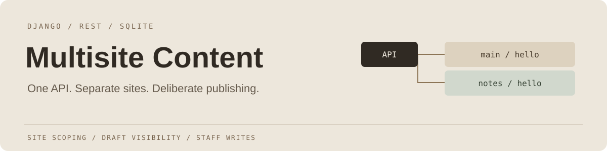
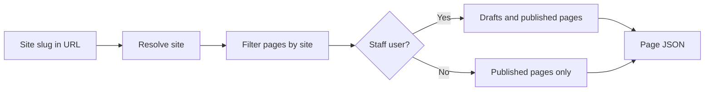

<div align="center">



# Multisite Content API

A Django REST API for pages that belong to different sites.

[](https://github.com/AugereAbove/multisite-content-api/actions/workflows/test.yml)
[](https://www.djangoproject.com/)
[](https://www.python.org/)
[](LICENSE)

[Quick start](#quick-start) · [API reference](docs/api.md) · [Design notes](docs/design.md) · [Contributing](CONTRIBUTING.md)

</div>

Keep content for several sites in one database without mixing their page URLs. Each site has its own slug namespace, public requests see only published pages, and staff use the same endpoints to manage drafts and published content.

The project includes Django admin, SQLite, database migrations, a repeatable demo setup, API tests, and a container configuration for local development.

## Quick start

Use Python 3.10 or newer.

```bash
git clone https://github.com/AugereAbove/multisite-content-api.git
cd multisite-content-api
python -m venv .venv
```

Activate the environment on Windows:

```powershell
.venv\Scripts\Activate.ps1
```

On macOS or Linux:

```bash
source .venv/bin/activate
```

Install dependencies, create the database, and load the example content:

```bash
python -m pip install -r requirements.txt
python manage.py migrate
python manage.py seed_demo
python manage.py createsuperuser
python manage.py runserver
```

Open [the public page list](http://127.0.0.1:8000/api/sites/main/pages/) or sign in to [Django admin](http://127.0.0.1:8000/admin/).

`seed_demo` creates the `main` and `notes` sites, a published `hello` page in each, and a draft in `main`. Running it again leaves existing sites and pages unchanged. It creates no user accounts or passwords.

## Try the API

```bash
curl http://127.0.0.1:8000/api/sites/main/pages/hello/
curl http://127.0.0.1:8000/api/sites/notes/pages/hello/
```

In Windows PowerShell, use `curl.exe` for these examples. The first request returns:

```json
{
  "slug": "hello",
  "title": "Hello",
  "body": "Welcome to the main site.",
  "published": true,
  "updated_at": "2026-10-21T12:00:00Z"
}
```

`updated_at` is generated when the page is saved; the timestamp above is illustrative. The second request returns a different page, despite using the same page slug.

Anonymous requests to `/api/sites/main/pages/draft/` return 404. A signed in staff user can read that draft and edit it through the browsable API or admin.

## Endpoints

| Method | Path | Access |
| :--- | :--- | :--- |
| GET | `/api/sites/{site}/pages/` | Published pages for visitors; all pages for staff |
| POST | `/api/sites/{site}/pages/` | Staff |
| GET | `/api/sites/{site}/pages/{slug}/` | Published page for visitors; drafts also visible to staff |
| PUT, PATCH | `/api/sites/{site}/pages/{slug}/` | Staff |
| DELETE | `/api/sites/{site}/pages/{slug}/` | Staff |

Site creation is handled through Django admin. The URL determines which site a page belongs to; a `site` field in a request body cannot move it elsewhere. Pages are sorted by slug and lists are not paginated.

See the [API reference](docs/api.md) for request bodies, authentication, validation errors, and examples of writes.

## How content stays separate



A database constraint makes each `(site, slug)` pair unique. The serializer catches ordinary duplicate create and rename attempts and returns a field validation error. Different sites can reuse the same page slug.

Staff access is global. This is content scoping by URL, not a separate staff membership system for each site.

## Run the checks

```bash
python manage.py check
python manage.py makemigrations --check --dry-run
python manage.py test
```

The tests cover site boundaries, draft visibility, every write method, duplicate slugs, validation, publishing, deletion, timestamps, admin sessions, CSRF enforcement, and demo setup.

GitHub Actions runs Django checks, migrations, and tests on Windows and Linux with Python 3.10, 3.12, and 3.13. A separate job builds the container and runs its checks and tests.

## Run with Docker

```bash
docker compose up --build
```

In another terminal:

```bash
docker compose exec api python manage.py seed_demo
docker compose exec api python manage.py createsuperuser
```

The service is bound to `127.0.0.1:8000`. Compose applies migrations before starting Django. Stop it with `docker compose down`.

SQLite lives inside the container. There is no persistent volume in this development configuration; removing or recreating the container can discard its database. A plain `docker run` does not apply migrations automatically.

## Development scope

The settings use a development key, `DEBUG=True`, SQLite, and Django's development server. They are meant for local use. Session authentication and Basic authentication are provided by Django REST Framework; session writes require CSRF tokens.

A deployed service needs its own environment settings, secret management, HTTPS, static file serving, application server, and backup strategy. The [design notes](docs/design.md) explain the current boundaries, including global staff access and concurrent slug conflicts.

## Project layout

```text
cms/                    Django settings and URL routing
content/
    models.py           Sites, pages, and the uniqueness constraint
    serializers.py      Page fields and scoped slug validation
    views.py            Site filtering and staff permissions
    tests.py            API, model, admin, and demo checks
    migrations/         Database schema
    management/         Demo setup command
docs/                   API reference and design notes
.github/                CI and contribution templates
Dockerfile              Development container image
compose.yaml            Local container service
```

## Contributing and license

See [CONTRIBUTING.md](CONTRIBUTING.md) for setup and checks. Report reproducible bugs in [Issues](https://github.com/AugereAbove/multisite-content-api/issues).

[MIT](LICENSE) © 2026 AugereAbove.
