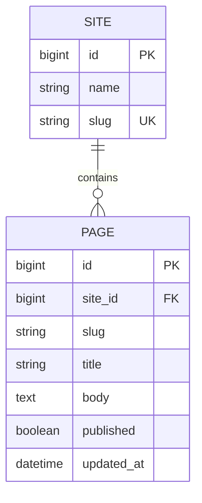

# Design notes

## Data model

A `Site` has a display name and a globally unique slug. A `Page` belongs to exactly one site and has a slug, title, body, publication flag, and save timestamp.

`unique_page_slug_per_site` is a database constraint over the site foreign key and page slug. Removing a site cascades to its pages. Default page ordering is ascending by slug.

The initial migration defines the schema. Changes to formatting do not alter the migration operations, field definitions, or constraint name.

## Request path

`cms/urls.py` extracts `site_slug` from the URL. `ScopedPages.get_site()` resolves it with a 404 on failure. Every page queryset is filtered to that site before publication visibility is applied.

`ReadOnlyOrStaff` permits safe methods for anyone and writes only for authenticated staff. The queryset also checks staff status: readers see published content only; staff see all pages in the selected site.

`PageList` provides list and create operations. Its `perform_create()` supplies the site from the URL. `PageDetail` looks up pages by slug inside the scoped queryset and provides retrieval, replacement, partial update, and deletion.

Staff status is global. There is no site membership table, role hierarchy, or permission rule restricting one editor to one site.

## Validation and serialization

`PageSerializer` exposes slug, title, body, publication state, and the read only timestamp. It leaves site assignment to the view.

Scoped slug validation checks for an existing page in the site from the view context. On update, it excludes the current instance, so retaining the same slug is valid. Without view context, this custom check is skipped; the database constraint still applies.

Ordinary duplicate writes return a field validation error. The check and save are not a single atomic conflict handling operation. A simultaneous write can pass the check and later encounter the database constraint.

## Authentication

The project uses Django REST Framework's default session and Basic authentication classes. Django admin supplies a local login flow. There is no token issuing endpoint or user registration API.

Session authentication enforces CSRF checks for authenticated writes. The tests exercise this with a client that enables CSRF enforcement, alongside a real admin session and unauthenticated requests.

## Demo data

`seed_demo` uses `get_or_create` for sites and pages. It supplies defaults only for missing records. Existing content is left alone, including a page with the same site and slug but different text or publication state.

The command creates two sites, two published pages sharing the `hello` slug, and a draft. It creates no credentials. This makes the main visibility and scoping behavior easy to try without changing existing content.

## Local settings and container

Django uses SQLite at `BASE_DIR / "db.sqlite3"`. The settings enable the messages framework, admin request context, and static files so the admin starts and its assets resolve under the development server.

The development key, debug mode, and host allowlist are explicit in `cms/settings.py`. The application does not read a `.env` file or provide deployment settings.

The Docker image installs requirements and starts `runserver`. Compose applies migrations first and exposes the service only on the host loopback address. The image context excludes local databases, credentials, Git metadata, and the Python environment.

There is no database volume. Container recreation can discard data. The image uses the development server and is not a production deployment configuration.

## Verification

The suite checks publication visibility for anonymous readers, authenticated readers, and staff; site scoping; every write method; field validation; slug conflicts; timestamps; deletion behavior; admin access; CSRF; and repeatable demo setup.

CI checks that Django starts, migrations match the models, the schema applies to a fresh database, and the tests pass across Windows and Linux. The container job builds the image and runs Django checks and tests inside it.

## Extending the project

Site specific editors would need an explicit membership model and checks on both reads and writes. Scheduled publishing would need a separate publication policy rather than relying on a boolean alone. Richer content, revision history, pagination, and concurrency handling each need their own API contract and tests.

For deployment, supply environment specific settings, a private secret, debug disabled, HTTPS, static file serving, an application server, and a persistence and backup plan appropriate to the database.
